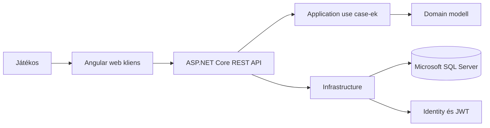

# City Escape Quest

[](https://github.com/kabai98/CityEscapeQuest/actions/workflows/backend-ci.yml)
[](https://github.com/kabai98/CityEscapeQuest/actions/workflows/frontend-ci.yml)

Városi, csapatos kalandjáték szabadulószobás hangulattal. A játékosok valódi helyszíneket járnak be, történetbe ágyazott nyomokat követnek, feladatokat oldanak meg, és közösen jutnak el a küldetés végéig.

> A projekt aktív MVP-fejlesztés alatt áll. A jelenlegi verzió fejlesztői előnézet, nem éles szolgáltatás.

## A játék lényege

Egy küldetés egy városi történetet és egymásra épülő kihívásokat kapcsol össze. A csapat PIN-kóddal csatlakozik egy lobbyhoz, elmegy a kezdőhelyszínre, majd a szerver GPS alapján ellenőrzi, hogy mindenki megérkezett-e. A játék ezután fedi fel a történetet és az első megoldandó feladatot.

Az első játszható küldetés, **A rejtélyes órásmester**, a budapesti Deák Ferenc téren indul. A csapat egy eltűnt órásmester nyomába ered, és egy helyszíni megfigyelésből származó kóddal állítja helyre a város óráit.

## Jelenlegi MVP

- regisztráció és bejelentkezés ASP.NET Core Identity alapon;
- JWT access token és forgatott, visszavonható refresh token;
- `Admin`, `User` és `Guest` szerepkörök;
- küldetéskatalógus és küldetésrészletek;
- játékszoba létrehozása és hatjegyű PIN-kódos csatlakozás;
- regisztráció nélküli vendégjátékosok;
- csapatlobby és résztvevőlista;
- résztvevőnkénti GPS-helyzetjelentés;
- szerveroldali geofence-, frissesség- és pontosságellenőrzés;
- `Lobby → InProgress → Completed` játékállapotok;
- történet, feladatbeküldés és szerveroldali megoldásellenőrzés;
- reszponzív, standalone komponensekre épülő Angular kliens.

## Hogyan épül fel?



A backend Clean Architecture elveket követ:

- **Domain** – küldetések, játékalkalmak, résztvevők, állapotátmenetek és üzleti szabályok;
- **Application** – a felhasználói folyamatokat megvalósító use case-ek és infrastruktúra-portok;
- **Infrastructure** – EF Core, SQL Server, Identity, JWT és refresh-token kezelés;
- **WebApi** – vékony kontrollerek, autentikáció, OpenAPI, `ProblemDetails` és rate limiting;
- **Angular** – standalone oldalak, routing, API-kliensek és autentikációs állapot.

A `Mission` az újrajátszható küldetéssablon. A `GameSession` egy csapat konkrét játékalkalma, a `Participant` pedig egy játékos tagságát és aktuális helyadatait kezeli. Így a küldetés tartalma és a futó játék állapota nem keveredik össze.

## Technológiák

| Terület | Technológia |
| --- | --- |
| Backend | .NET 10, ASP.NET Core Web API |
| Frontend | Angular 22, TypeScript 6, RxJS |
| Adatbázis | Microsoft SQL Server, EF Core 10 |
| Biztonság | ASP.NET Core Identity, JWT, refresh-token rotáció |
| Tesztelés | xUnit, `WebApplicationFactory` |
| Automatizálás | GitHub Actions |

## Projektstruktúra

```text
CityEscapeQuest.slnx
├── src/
│   ├── CityEscapeQuest.Domain/
│   ├── CityEscapeQuest.Application/
│   ├── CityEscapeQuest.Infrastructure/
│   └── CityEscapeQuest.WebApi/
├── tests/
│   ├── CityEscapeQuest.Domain.UnitTests/
│   ├── CityEscapeQuest.Application.UnitTests/
│   ├── CityEscapeQuest.Infrastructure.IntegrationTests/
│   └── CityEscapeQuest.WebApi.IntegrationTests/
└── frontend/
    └── city-escape-quest-web/
```

## Helyi fejlesztés

Szükséges: .NET SDK 10.0.301 vagy kompatibilis patch verzió, Node.js/npm, valamint Microsoft SQL Server vagy LocalDB.

```powershell
dotnet restore CityEscapeQuest.slnx
dotnet ef database update `
  --project src/CityEscapeQuest.Infrastructure `
  --startup-project src/CityEscapeQuest.WebApi
dotnet run --project src/CityEscapeQuest.WebApi
```

Egy külön terminálban:

```powershell
cd frontend/city-escape-quest-web
npm ci
npm start
```

A JWT aláírókulcsot legalább 32 karakteres környezeti változóként vagy .NET user secretként kell megadni. Hitelesítő adatot ne commitolj a repositoryba.

## Ellenőrzés

```powershell
dotnet test CityEscapeQuest.slnx --configuration Release
cd frontend/city-escape-quest-web
npm run check
```

## Roadmap

- több állomásból és többféle feladattípusból álló küldetések;
- fényképes bizonyíték és hangfelismerés;
- achievementek és játékosprofil-statisztikák;
- barátok és meghívások e-maillel vagy QR-kóddal;
- adminisztrációs felület és küldetésszerkesztő;
- Ionic mobilalkalmazás;
- fizetős küldetések és fizetési integráció.

## Közreműködés

A fejlesztés rövid életű feature brancheken történik. Módosítás előtt érdemes issue-t vagy rövid tervet készíteni, majd a változtatást tesztekkel és pull requesttel beküldeni a `main` branch felé.

## Licenc

A repository jelenleg nem tartalmaz nyílt forráskódú licencet. A forráskód felhasználási és terjesztési feltételei ezért nincsenek nyilvánosan engedélyezve.
